<p align="center">
  <picture>
    <source media="(prefers-color-scheme: dark)" srcset="./.github/assets/logo-on-dark.svg">
    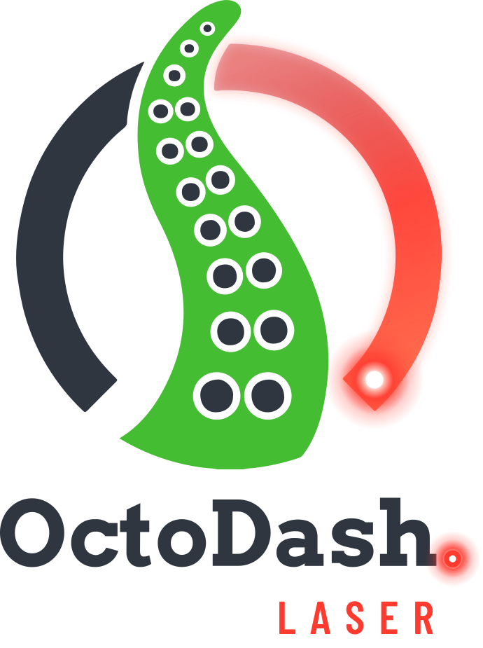
  </picture>
</p>

<p align="center">
  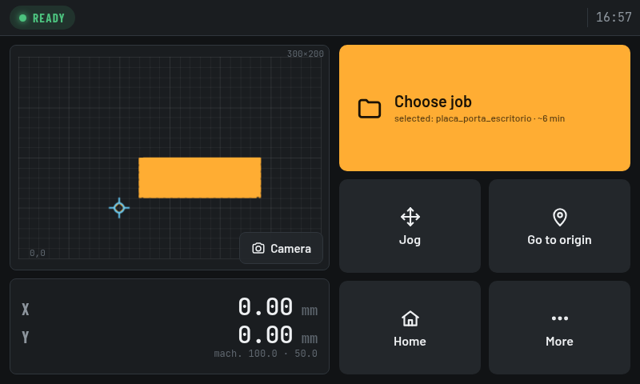
</p>

<p align="center">
  <b>A touchscreen dashboard for GRBL laser engravers running on OctoPrint.</b><br>
  Fork of <a href="https://github.com/UnchartedBull/OctoDash">OctoDash</a> 2.8.0, redesigned for lasers (K40-class CO₂ and diode machines).
</p>

---

OctoDash is a beautiful touch UI for OctoPrint, but it is built around 3D printers: temperatures, filament,
extruders, layers. OctoDash-Laser keeps OctoDash's foundation (Electron app, OctoPrint API/socket, setup wizard,
screen sleep) and replaces every screen with a laser workflow designed for a 7" 800×480 display next to the
machine: see where the head is, jog it, frame the job, run a short pre-flight checklist, start, pause and stop.

It talks to GRBL through **OctoPrint + [Better Grbl Support](https://github.com/synman/Octoprint-Bettergrblsupport)**.
OctoPrint owns the serial port, so jobs can still be sent from a desktop app (LightBurn, RayForge, LaserGRBL…
via OctoPrint upload) and the touchscreen follows them automatically.

## Features

**Main screen**

- Live GRBL state (Ready, Running, Paused, Moving, Alarm, Door open, Offline) in a status pill
- Bed map (to scale, e.g. 300×200 mm) with the laser head, the work origin and the selected job outline
- Work and machine coordinates
- One tap swaps the map for a **live camera** (MJPEG, e.g. go2rtc)
- Alarm, door-open and offline states replace the main button with the fix (Home / Unlock / Connect)

**Jog**

- 8-direction pad with diagonals and step sizes 0.1 / 1 / 10 / 50 mm (configurable)
- **Continuous jog (∞)**: moves while the button is held and stops when released. It uses short `$J`
  segments plus the GRBL jog-cancel, so the head stops within one segment even if the cancel is lost
- Jogging is clamped to the bed when the position is known
- Set origin here (`G10 L20 X0 Y0`), Go to origin, Home (`$H`), Unlock (`$X`)
- **Test fire**: press and hold, with configurable power and duration

**Jobs**

- G-code files from OctoPrint, newest first
- Each file is parsed on the device: toolpath preview, size, estimated time (arcs and rapids included) and power range
- Warning when the job would leave the bed from the current origin
- **Frame**: traces the job outline with the laser off

**Before you start**

- Checklist: machine idle, job inside the work area, framed, plus your own manual items (lid closed, water
  flowing, air assist…)
- It only **warns**, it never blocks (door and interlocks are the firmware's job)
- **Slide to start**, so a stray touch never starts the laser

**Running**

- Progress drawn on the toolpath, %, time left / elapsed, estimated end time
- Pause / Resume with one tap ("Pausing… finishing the current move" until GRBL confirms)
- **Stop: hold for 1 s**
- Opens automatically when a job starts from anywhere (desktop app, OctoPrint web UI)
- GRBL alarms explained in plain language, with the next step to take

**More & settings**

- Custom G-code buttons (from the config), reload, restart OctoPrint, shut down (two-tap confirm)
- Laser-only settings, editable on the touchscreen (± steppers for numbers, so no keyboard is needed for those):
  - **Machine**: name, bed size, machine origin, Y axis direction
  - **Motion**: jog speed (mm/s), steps, default step, continuous limit, rapid feed (for estimates), invert arrows
  - **Laser**: max power (= GRBL `$30`), test-fire power/duration, checklist items
  - **Camera**: on/off and stream URL with live preview
  - **Screen**: language, screen off while sleeping, sleep/wake commands
  - **Connection**: OctoPrint URL and API key
  - **About**: version, reset configuration

**Other**

- **English and Portuguese** UI, switchable in Settings › Screen
- Notifications, standby screen and setup wizard restyled; 3D-printer pages removed
- No update prompt pointing to the original OctoDash (it would install the 3D-printer version)

## Screenshots

|                                                            |                                                            |
| ---------------------------------------------------------- | ---------------------------------------------------------- |
|               | 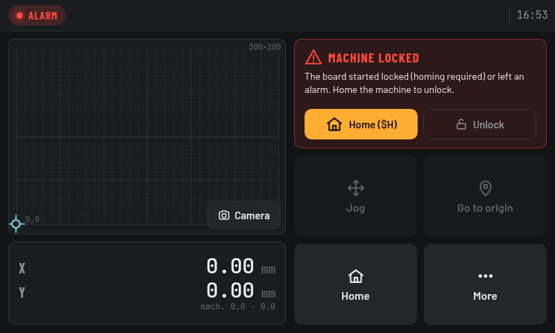 |
| Main screen: bed map, head, origin, selected job           | Alarm: the main button becomes the fix                     |
| 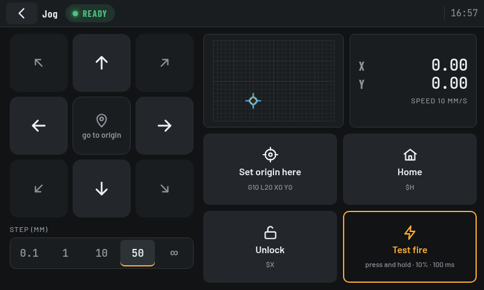                             | 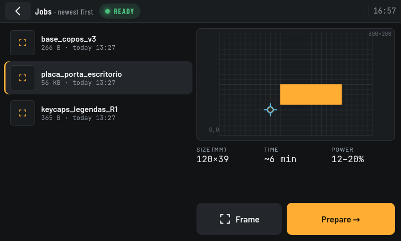                           |
| Jog: steps or continuous, origin, home, test fire          | Jobs: toolpath preview, size, time, power, frame           |
| 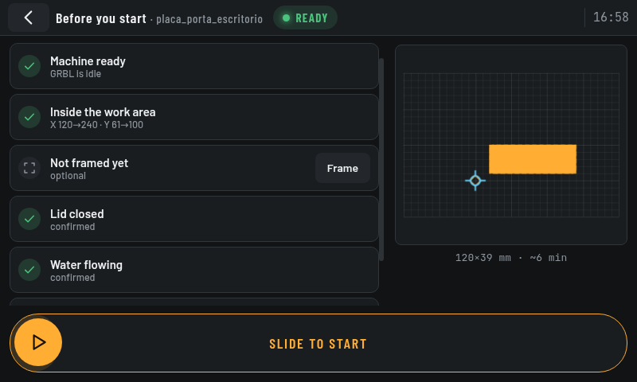            | 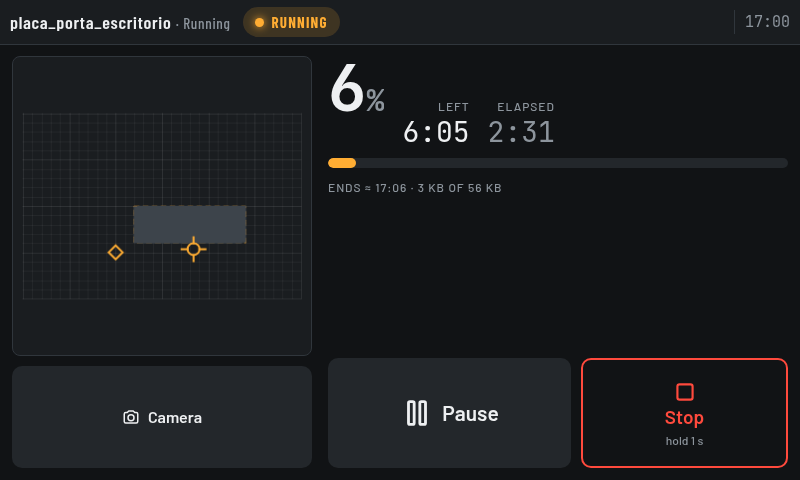                     |
| Before you start: checklist + slide to start               | Running: progress, time left, pause, hold-to-stop          |
| 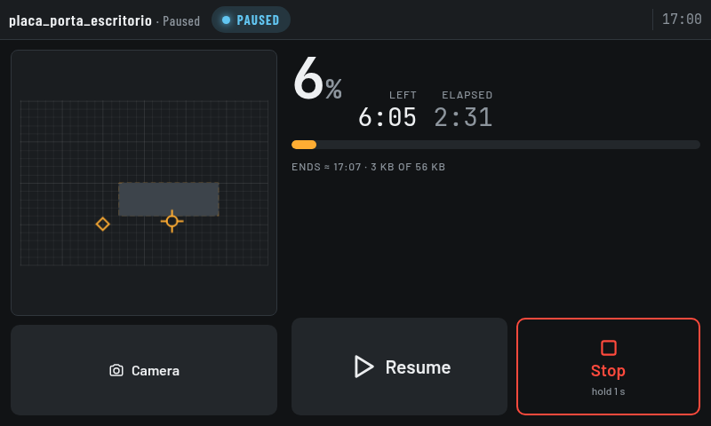                       | 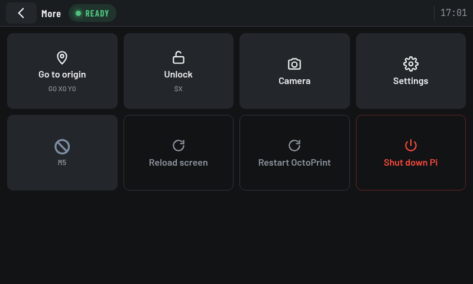                           |
| Paused                                                     | More: shortcuts, custom actions, system                    |
| 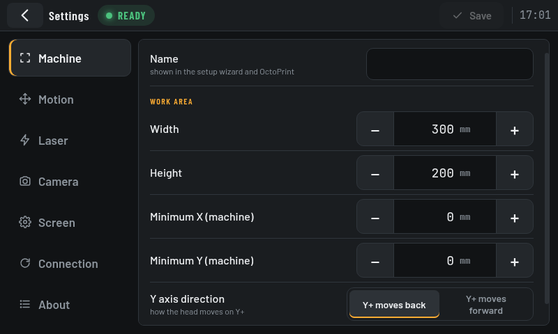 | 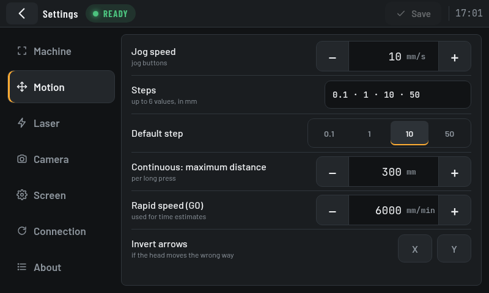   |
| Settings: machine                                          | Settings: motion                                           |
| 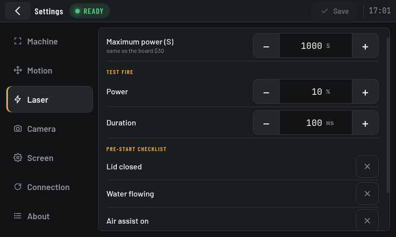     | 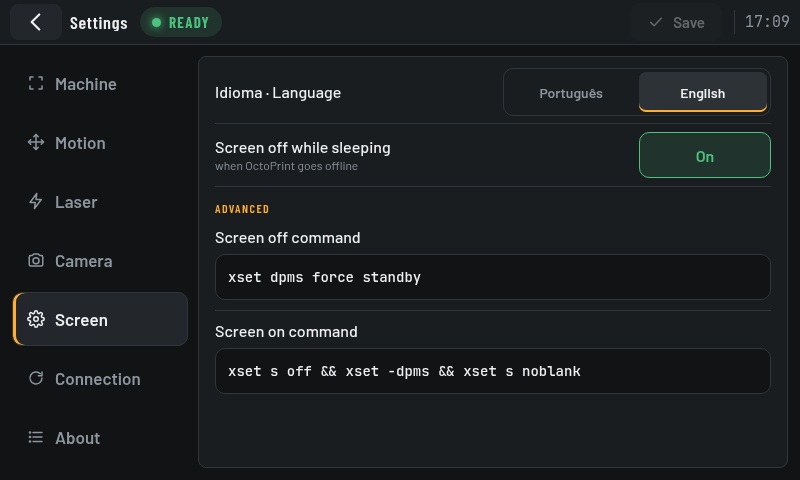   |
| Settings: laser and checklist                              | Settings: language and screen                              |
| 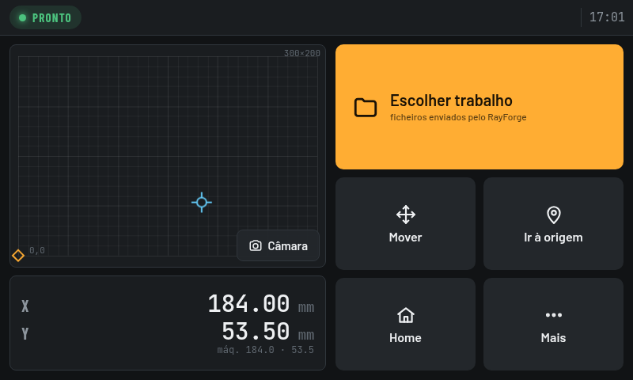               |                                                            |
| Portuguese UI                                              |                                                            |

Screenshots taken at 800×480 against OctoPrint 1.11 + Better Grbl Support + grbl-sim (GRBL 1.1h firmware).
The camera view is not shown because the simulator has no camera.

## Requirements

- Raspberry Pi (or another Debian-based Linux machine) with a landscape touchscreen; designed for 800×480, scales to other sizes
- OctoPrint 1.9+ with the **Better Grbl Support** plugin, connected to a GRBL 1.1 board
- CORS enabled in OctoPrint (Settings › API › Allow CORS)
- Optional: an MJPEG camera stream (e.g. [go2rtc](https://github.com/AlexxIT/go2rtc) `/api/stream.mjpeg?src=…`)

## Installation

Run as the user that logs in on the display (usually `pi`), not as root:

```bash
bash <(wget -qO- https://github.com/andrezibaia/OctoDash-Laser/raw/main/scripts/install.sh)
```

The installer downloads the latest release for your architecture (`arm64`, `armv7l` or `amd64`) and installs its
dependencies. It offers to install Better Grbl Support, enables CORS and can set up autostart (X + ratpoison).
A downloaded package can also be installed by hand:

```bash
sudo apt install ./octodash-laser_<version>_arm64.deb
```

The app lives in `/opt/OctoDash-Laser/octodash-laser`; the config is `~/.config/octodash-laser/config.json`.
On first start the setup wizard asks for the OctoPrint instance, the API key and the machine name.

Update: `bash <(wget -qO- https://github.com/andrezibaia/OctoDash-Laser/raw/main/scripts/update.sh)`

### Better Grbl Support notes

- The panel **never sends `$I`, `$G`, `$#` or `$$`**. Better Grbl Support matches replies to requests in
  order; an extra query desynchronises it, it stops polling `?` and OctoPrint drops the board after ~90 s.
- If OctoPrint loses the board about 1.5 min after connecting, empty the `afterPrinterConnected` GCODE script
  in OctoPrint (Better Grbl Support puts an `M999` reset there that can race with its own start-up queries).
- Set **Max power** in Settings › Laser to your board's `$30` so power percentages are right.

## Building

```bash
docker run --rm -v "$PWD:/app" -w /app -e HOME=/tmp -u $(id -u):$(id -g) node:22-bookworm \
  bash -c "npm ci && npm run lint && npx ng build --configuration production && \
           npx electron-builder build -l deb --arm64 --armv7l"
```

Packages are written to `package/`. Publishing a GitHub release runs the CI workflow, which builds the `.deb`
files and attaches them to the release.

`python3 scripts/check-laser-i18n.py` fails if any text on the laser screens is missing an English translation.

### Testing without a machine

`test-env/` runs OctoPrint 1.11 + Better Grbl Support + **grbl-sim** (the real GRBL 1.1h firmware compiled for
the PC) in Docker:

```bash
cd test-env && docker build -t odl-testenv . && \
docker run -d --name odl-octoprint -p 127.0.0.1:5080:5000 odl-testenv && sleep 60 && ./connect.sh
```

Serve `dist/` and open `/en/index.html` in a browser at 800×480. Outside Electron the app keeps its config in
`localStorage` (key `octodash-laser-config`); point it at `http://127.0.0.1:5080/` with the test API key from
`test-env/connect.sh`.

Design notes (in Portuguese): [LEIA-ME.md](LEIA-ME.md).

## Credits & license

OctoDash-Laser is a fork of [OctoDash](https://github.com/UnchartedBull/OctoDash) by Timon Gaebelein
(UnchartedBull) and contributors, licensed under the [Apache License 2.0](LICENSE.md). See [NOTICE](NOTICE) for
what was changed. Fonts: Barlow, Barlow Condensed and JetBrains Mono (SIL Open Font License, see `src/assets/fonts/`).

Not affiliated with OctoPrint, OctoDash or Better Grbl Support. Lasers are dangerous: never leave a running laser
unattended, and do not rely on this UI as a safety device.
